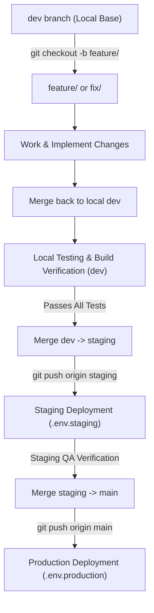

# Klarone Deployment & Branching Protocol

## 1. Core Rule: Protected Remote Branches
Only two branches are permitted to exist on GitHub (`origin`):
1. **`staging`** - Connected to the automated Staging deployment pipeline.
2. **`main`** - Connected to the automated Production deployment pipeline.

> [!CAUTION]
> **NEVER push feature, fix, or dev branches to GitHub.**
> No branch other than `staging` and `main` may be pushed to `origin`. Any temporary branch created remotely must be immediately pruned.

---

## 2. Environment Configuration Matrix

Each deployment environment is tied strictly to its designated configuration files:

| Environment | Branch | Deployment Target | Config & Secrets Files |
| :--- | :--- | :--- | :--- |
| **Local Development** | `dev` / `feature/*` / `fix/*` | `localhost:3000` (API), `localhost:3001` (Web) | `.env.local` |
| **Staging Environment** | `staging` | Staging Web & API deployments | `.env.staging`<br>`.env.staging.mcp` |
| **Production Environment** | `main` | Live Production Web & API | `.env.production`<br>`.env.production.mcp` |

---

## 3. Standard Feature & Fix Lifecycle Workflow



### Step 1: Branch Creation
Always cut your working branch from the local `dev` branch:
```bash
git checkout dev
git checkout -b feature/<feature-name>   # or fix/<fix-name>
```

### Step 2: Implementation & Commit
Implement code, write unit/integration tests, and commit locally:
```bash
git add <files>
git commit -m "feat(<scope>): <description>"
```

### Step 3: Local Integration into `dev`
Switch back to `dev` and merge your feature branch:
```bash
git checkout dev
git merge feature/<feature-name>
git branch -d feature/<feature-name>
```

### Step 4: Local Testing & Monorepo Build Verification
Before promoting to staging, run full build verification locally on `dev`:
```bash
pnpm --filter api build
pnpm --filter web build
```

### Step 5: Promotion to `staging` (Pushed to GitHub)
Once verified on `dev`, merge into `staging` and push **only** `staging` to GitHub:
```bash
git checkout staging
git merge dev
git push origin staging
```
*Staging deployment triggers automatically using `.env.staging` and `.env.staging.mcp`.*

### Step 6: Promotion to `main` (Production)
After confirming stability on the live staging environment:
```bash
git checkout main
git merge staging
git push origin main
```
*Production deployment triggers automatically using `.env.production` and `.env.production.mcp`.*
